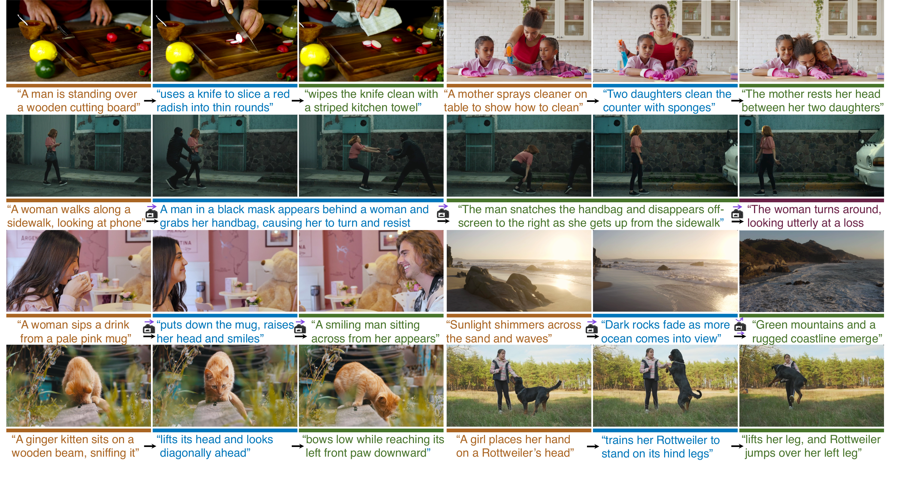
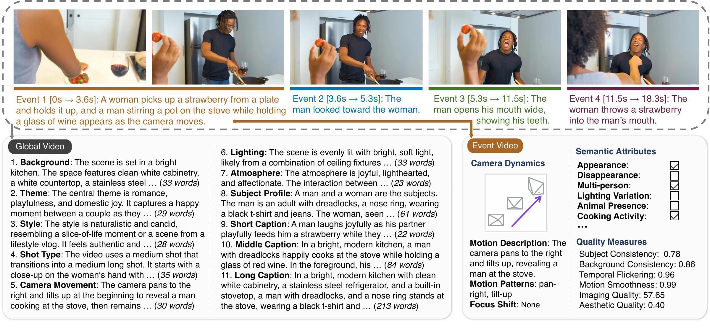

<h1> MEV: Multi-Event Video Dataset</h1>

<p align="center">
  <a href="https://mev-dataset.github.io/"></a>&nbsp;
  <a href="https://huggingface.co/datasets/MultiEventVideo/MEV"></a>&nbsp;
  <a href="mev_eval/README.md"></a>&nbsp;
  <a href="#citation"></a>&nbsp;
  <a href="#citation"></a>
</p>

- 🧩 **The first public dataset for long-take video generation with temporally grounded, structured global–event captions**, to our knowledge.
- 🎬 **High-quality long-take videos with fine-grained event-level annotations**, including camera motion, semantic attributes, and video-quality scores.
- 📊 **MEV-Eval measures event execution, order, temporal grounding, and transition coherence** in generated videos.

<p align="center">
  <a href="https://mev-dataset.github.io/">
    
  </a>
</p>

## Get the dataset

Start with the [Hugging Face dataset](https://huggingface.co/datasets/MultiEventVideo/MEV), or download only the annotations:

```bash
# Use Python 3.10+ for current Hugging Face tools.
python -m pip install -U huggingface_hub
hf download MultiEventVideo/MEV annotations/mev.json LICENSE \
  --repo-type dataset --local-dir data/MEV
```

For a smaller video sample, event-table loading, full video downloads, and the annotation schema, see the **[dataset guide](docs/DATASET.md)**.

<p align="center">
  
</p>

## Try MEV-Eval

The evaluator supports Python 3.8+. From the repository root:

```bash
cd mev_eval
python -m pip install -r requirements.txt

# Re-score the bundled judge response without an API key or video download.
mkdir -p outputs/example/raw
cp examples/raw_result.mev_eval.json outputs/example/raw/
python -m mev_eval.summarize --output-dir outputs/example --rescore
```

This writes `per_video_metrics.csv` and `summary_metrics.json`. The single bundled result is a usage example, not a benchmark result.

To evaluate your own generated videos, prepare the prompt records used to generate them and supply the MEV annotation file:

```bash
# Still in mev_eval/. Replace the records and video paths with your own inputs.
export GEMINI_API_KEY='your-api-key'
python -m mev_eval.evaluate \
  --records-json /path/to/records.json \
  --video-dir /path/to/generated_videos \
  --annotation-json ../data/MEV/annotations/mev.json \
  --output-dir outputs/my_method
```

Live judging uploads the generated videos to the Gemini API and may incur API charges. The defaults are Gemini 2.5 Pro, temperature 0, and thinking budget 128. The annotation file supplies the duration-based temporal targets used in the paper.

See **[MEV-Eval documentation](mev_eval/README.md)** for input formats, metric formulas, sharded execution, caching, and offline re-scoring. See **[reproducibility notes](docs/REPRODUCIBILITY.md)** for what is included and what is still needed to reproduce the paper's exact prompt draws.

## Repository contents

```text
.
├── README.md                 # Project overview and entry points
├── CITATION.cff              # Machine-readable citation
├── LICENSE                   # MIT license for code
├── DATA_LICENSE.md           # Annotation and video licensing
├── assets/                   # Paper figures rendered for GitHub
├── docs/                     # Dataset access, reproducibility, release notes
├── mev_eval/                 # Evaluator, launcher, examples, and tests
└── .github/                  # Offline test workflow and issue templates
```

## Citation

If you use MEV or MEV-Eval, please cite:

```bibtex
@misc{mev2026,
  title  = {MEV: A Multi-Event Video Dataset for Long-Take Generation},
  author = {Zhu, Peiyuan and Xie, Shaoan and Shen, Yifan and Tian, Wen and
            Li, Zijian and Chen, Guangyi and Zhang, Kun},
  year   = {2026},
  url    = {https://mev-dataset.github.io/}
}
```

Citation metadata is also available in [CITATION.cff](CITATION.cff).

## License and support

Code is released under the [MIT License](LICENSE). MEV-created annotations and metadata are CC BY 4.0; video assets retain their source-specific terms. See [data licensing](DATA_LICENSE.md) and the [official dataset license](https://huggingface.co/datasets/MultiEventVideo/MEV/blob/main/LICENSE).

For evaluator bugs, open a GitHub issue with a minimal example. For dataset access or annotation questions, use the [Hugging Face discussion page](https://huggingface.co/datasets/MultiEventVideo/MEV/discussions). Contributions are welcome; see [CONTRIBUTING.md](CONTRIBUTING.md).
